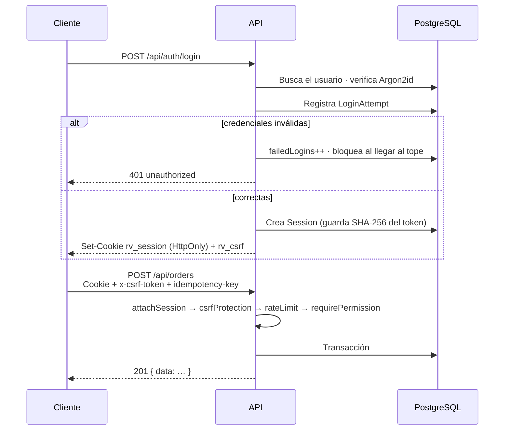
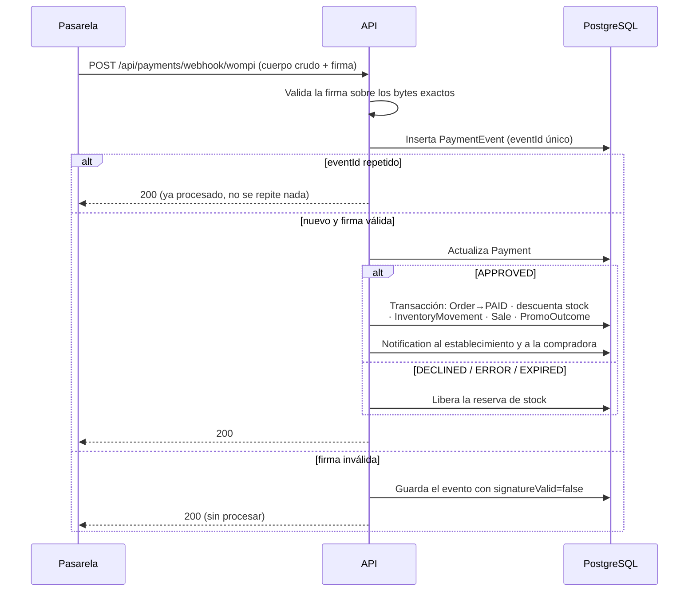

# Diseño de la API y de los webhooks

- **Base:** `/api`
- **Especificación:** OpenAPI **3.1.0** — [`openapi.yaml`](./openapi.yaml) · [`openapi.json`](./openapi.json)
- **Documentación interactiva:** `/api/docs` (Swagger UI) y `/api/openapi.json` en el servidor en marcha
- **Fuente de verdad:** `server/src/openapi.ts`. Los archivos de esta carpeta se
  **generan**: `npm run docs:openapi`
- **Cobertura: sin deriva.** Las 86 rutas registradas en el código están
  documentadas, salvo los 2 endpoints del simulador de pagos, excluidos a
  propósito. Lo verifica `npm run docs:openapi:check` (ver
  [la comprobación](#deriva-entre-el-código-y-la-especificación))

## Convenciones

### Formato de respuesta

Toda respuesta correcta envuelve el contenido en `data`:

```json
{ "data": { "id": "…", "name": "…" } }
```

Las listas paginadas añaden `meta`:

```json
{
  "data": [ … ],
  "meta": { "page": 1, "pageSize": 20, "total": 134, "totalPages": 7 }
}
```

Los errores usan siempre la misma forma (`server/src/lib/errors.ts`):

```json
{ "error": { "code": "validation_error", "message": "El precio debe ser mayor que cero.", "details": { … } } }
```

El `message` **está escrito para mostrarse a la persona**, en español. El `code`
es para el cliente.

### Códigos de estado

| Código | Cuándo |
|---|---|
| `200` | Lectura o actualización correcta |
| `201` | Recurso creado |
| `400` | `validation_error` — Zod rechazó la entrada |
| `401` | `unauthorized` — sin sesión o sesión vencida |
| `403` | `forbidden` — el rol no tiene el permiso, o el recurso es de otro establecimiento |
| `404` | `not_found` — también cuando el recurso existe pero es de otro inquilino (no se filtra su existencia) |
| `409` | `conflict` — stock insuficiente, correo ya registrado, estado incompatible |
| `422` | `unprocessable` — la petición es válida pero la regla de negocio la rechaza |
| `429` | `rate_limited` — límite de peticiones excedido |
| `500` | `internal_error` — sin detalle hacia fuera; el detalle va al log con el `requestId` |
| `503` | La base de datos no responde (solo `/api/health`) |

### Encabezados

| Encabezado | Dirección | Para qué |
|---|---|---|
| `x-request-id` | entra y sale | Correlación. Si el cliente lo manda, se respeta; si no, se genera. Aparece en cada línea de log |
| `x-csrf-token` | entra | **Obligatorio en todo método que modifica datos.** Debe repetir el valor de la cookie `rv_csrf` |
| `idempotency-key` | entra | Órdenes y pagos. Permite reintentar sin duplicar |
| `idempotent-replay` | sale | `true` si la respuesta viene de una petición idéntica anterior |
| `x-unread-count` | sale | Notificaciones sin leer |
| `x-ratelimit-remaining` | sale | Peticiones restantes en la ventana |

### Paginación, orden y filtros

`?page=1&pageSize=20` (tope de `pageSize` para no permitir volcados completos).
Los filtros son explícitos por recurso (`?category=`, `?level=`, `?status=`,
`?search=`); no hay lenguaje de consulta genérico, a propósito.

## Autenticación

**Sesión opaca en cookie, no JWT.** Al iniciar sesión se emiten dos cookies:

| Cookie | Contenido | Banderas |
|---|---|---|
| `rv_session` | Token opaco aleatorio. En la base solo vive su **SHA-256** | `HttpOnly`, `Secure` (producción), `SameSite` configurable, con expiración |
| `rv_csrf` | Token de doble envío | **legible por JS** a propósito: el cliente lo copia en `x-csrf-token` |

Razón de la decisión: un JWT en `localStorage` es accesible por XSS y no se puede
revocar. Una sesión en base de datos se revoca al instante
(`DELETE /api/auth/sessions/{id}`) y la cookie `HttpOnly` no la lee JavaScript.
La sesión se renueva de forma deslizante en `GET /api/auth/session`.



## Mapa de endpoints

Los 86 endpoints registrados, por módulo. El detalle de parámetros y esquemas
está en [`openapi.yaml`](./openapi.yaml).

### Salud · `server/src/app.ts`

| Método | Ruta | Acceso | Nota |
|---|---|---|---|
| `GET` | `/api/health` | público | Verifica la base con `SELECT 1`. `503` si no responde |

### Autenticación · `/api/auth` (15)

| Método | Ruta | Acceso |
|---|---|---|
| `POST` | `/register` | público — **siempre crea rol `cliente`** |
| `POST` | `/login` | público, con límite estricto |
| `POST` | `/logout` | sesión |
| `GET` | `/session` | público — sesión vigente y renovación deslizante |
| `GET` | `/sessions` | sesión — dispositivos activos |
| `DELETE` | `/sessions/{id}` | sesión — revocar |
| `POST` | `/verify-email` · `/verify-email/resend` | público / sesión |
| `POST` | `/password/forgot` · `/password/reset` | público |
| `POST` | `/password/change` | sesión |
| `GET` · `PATCH` | `/me` | sesión |
| `POST` | `/bootstrap-superadmin` | token `SUPERADMIN_BOOTSTRAP_TOKEN` |

### Usuarios · `/api/users` (2)

| Método | Ruta | Acceso |
|---|---|---|
| `GET` | `/{id}` | permiso `users:read` |
| `DELETE` | `/me` | sesión — **baja lógica con anonimización** (Habeas Data) |

### Establecimientos · `/api/establishments` (9)

Directorio público, creación por superadmin, edición propia, solicitudes de
cuenta y gestión de miembros (`owner` · `manager` · `staff`).

### Productos e inventario · `/api/products` (7) · `/api/inventory` (5)

CRUD con baja lógica, aplicación de descuento, categorías, resumen de
existencias, próximos a vencer, kardex de movimientos, ajuste y merma.

### Inteligencia · `/api/alerts` (4) · `/api/recommendations` (3)

| Método | Ruta | Nota |
|---|---|---|
| `GET` | `/api/alerts` | **Recalcula el Risk Score** antes de responder |
| `GET` | `/api/alerts/counts` | Conteo por nivel, para la insignia del nav |
| `POST` | `/api/alerts/{id}/snooze` · `/resolve` | |
| `GET` | `/api/recommendations/{productId}` | Explicabilidad + histórico de la categoría |
| `POST` | `/api/recommendations/{productId}/apply` | Aplica descuento, publica o registra donación |

### Marketplace · `/api/marketplace` (5)

Catálogo **público** (sin sesión), ficha, conteos para filtros, y
publicar/despublicar con permiso `marketplace:publish`.

### Carrito y pedidos · `/api/cart` (5) · `/api/orders` (8)

| Método | Ruta | Nota |
|---|---|---|
| `GET` | `/api/cart` | **Recalcula precios al leer**: el carrito nunca sirve un precio viejo |
| `POST` | `/api/orders` | Acepta `idempotency-key` y el objeto `consent`. **Reserva stock** |
| `POST` | `/api/orders/{id}/checkout` | Crea la intención de pago y devuelve la URL del checkout alojado |
| `POST` | `/api/orders/{id}/cancel` | Libera la reserva |
| `POST` | `/api/orders/{id}/deliver` | Permiso `orders:manage` |
| `GET` | `/api/orders/establishment` · `/admin/all` | Vista del establecimiento · del superadmin |

**Los totales se calculan siempre en el servidor.** El cliente nunca envía
precios: manda `productId` y `quantity`.

### Pagos · `/api/payments` (6)

| Método | Ruta | Acceso | Nota |
|---|---|---|---|
| `GET` | `/config` | sesión | Llave pública y proveedor activo |
| `GET` | `/status/{orderId}` | sesión | Para consultar mientras se espera el webhook |
| `POST` | `/webhook/{provider}` | **público, con firma** | Ver abajo |
| `GET` | `/{paymentId}/events` | sesión | Trazabilidad |
| `GET`/`POST` | `/mock/checkout` · `/mock/simulate` | **solo fuera de producción** | Simulador local |

### Métricas · `/api/dashboard` (5) · `/api/admin` (10) · `/api/notifications` (3)

KPIs del establecimiento, priorización, ventas, resultados de promociones, el
impacto propio de la compradora; resumen global, establecimientos con métricas,
publicaciones, solicitudes con aprobación/rechazo, usuarios, bitácora de
auditoría y eventos de pasarela; notificaciones y marcado de leídas.

### Utilidades de desarrollo · `/api/dev` (3)

`/demo-accounts`, `/run-jobs`, `/pay`. **Montadas solo si `NODE_ENV !== 'production'`**
(`if (!env.isProd)` en `app.ts`).

---

## Webhooks

### Entrante: pasarela de pagos

`POST /api/payments/webhook/{provider}` — la **única** fuente de verdad del
cobro. La redirección del navegador después de pagar no confirma nada.

Decisiones de diseño, todas visibles en `app.ts` y `modules/payments/`:

1. **Se registra antes del parser de JSON** y recibe el cuerpo crudo
   (`express.raw`, tope 256 kB): la firma se valida sobre los bytes exactos.
2. **Queda fuera de CSRF y de la sesión**: quien llama es la pasarela, no un navegador.
3. **Se valida la firma** (`parseEvent` del adaptador). Un evento con firma
   inválida se **persiste** con `signatureValid: false` y no se procesa: queda la
   evidencia del intento.
4. **`eventId` es único en base de datos.** Un reenvío no vuelve a mover
   inventario ni a confirmar la orden.
5. **Se responde `200` rápido** incluso ante un evento duplicado o desconocido:
   si la pasarela recibe un error, reintenta en bucle.
6. **El estado del proveedor se traduce** a `PaymentStatus` (`mapWompiStatus`), y
   solo `APPROVED` dispara la transacción de confirmación.



### Salientes

**No hay webhooks salientes.** `TODO:` si algún día se integra con el POS del
establecimiento, aquí va el contrato (reintentos con retroceso exponencial,
firma HMAC propia y registro de entregas).

## Integraciones externas

| Integración | Abstracción | Implementaciones | Sandbox |
|---|---|---|---|
| **Pagos** | `PaymentProviderAdapter` (`modules/payments/provider.ts`) | `wompi` (real) · `mock` (local) | `WOMPI_API_URL` apunta a sandbox por defecto; cobrar en producción exige `PAYMENTS_LIVE_ENABLED=true` |
| **Correo** | `sendMail()` (`lib/mailer.ts`) | `log` (imprime en consola) · `smtp` (nodemailer) | `MAIL_TRANSPORT=log` en desarrollo; SMTP **obligatorio** en producción |
| **SMS** | ⬜ **no existe** | — | `TODO:` definir si hace falta (ver [`integraciones.md`](../integraciones.md)) |

Detalle de credenciales, modo sandbox y manejo de errores en
[`../integraciones.md`](../integraciones.md).

## Cómo probar la API

```bash
npm run db:up                       # PostgreSQL en Docker
npm run db:migrate && npm run db:seed
npm run dev:api                     # http://localhost:4000
open http://localhost:4000/api/docs # Swagger UI

# Con curl (la cookie y el CSRF se manejan solos con -c/-b)
curl -s localhost:4000/api/health | jq
curl -s -c /tmp/rv.txt -X POST localhost:4000/api/auth/login \
  -H 'content-type: application/json' \
  -d '{"email":"supermercado1@reverde.com","password":"Demo1234"}' | jq

npm run test:api                    # 10 archivos de pruebas de integración
```

## Deriva entre el código y la especificación

Una especificación solo sirve si refleja la realidad. `npm run docs:openapi:check`
(`scripts/check-openapi-drift.mjs`) extrae las rutas registradas en
`server/src/modules/*/routes.ts`, las compara con `openapi.json` y **falla con
código distinto de cero** si alguna quedó sin documentar. Corre en la CI, así que
un endpoint nuevo sin documentar rompe el build.

```
$ npm run docs:openapi:check
Rutas en el código: 86 · documentadas: 85

Excluidas a propósito (2):
  · GET /api/payments/mock/checkout — simulador de pagos, solo fuera de producción
  · POST /api/payments/mock/simulate — simulador de pagos, solo fuera de producción

✓ Sin deriva: toda ruta registrada está documentada.
```

Las exclusiones deliberadas se declaran con su motivo en `ALLOWED_UNDOCUMENTED`
dentro del script; no se pueden omitir en silencio.

Al cambiar la API el flujo es: editar `server/src/openapi.ts` →
`npm run docs:openapi` → commitear también `openapi.yaml` y `openapi.json`.

## Pendientes de la API

| # | Pendiente | Impacto |
|---|---|---|
| A1 | Documentar los 2 endpoints del simulador o excluirlos en la especificación misma | Hoy la exclusión vive en el script, no en el contrato |
| A2 | `TODO:` versionar la API (`/api/v1`) antes de tener clientes externos | Hoy no hay clientes externos; cambiar después es caro |
| A3 | El límite de peticiones es en memoria por proceso | Con varias réplicas hay que moverlo a Redis |
| A4 | `TODO:` definir el contrato de errores de validación anidados | Hoy `details` lleva el error de Zod en crudo |
| A5 | La SPA todavía no consume nada de esto (Must-have M14) | **El riesgo principal del proyecto** |
