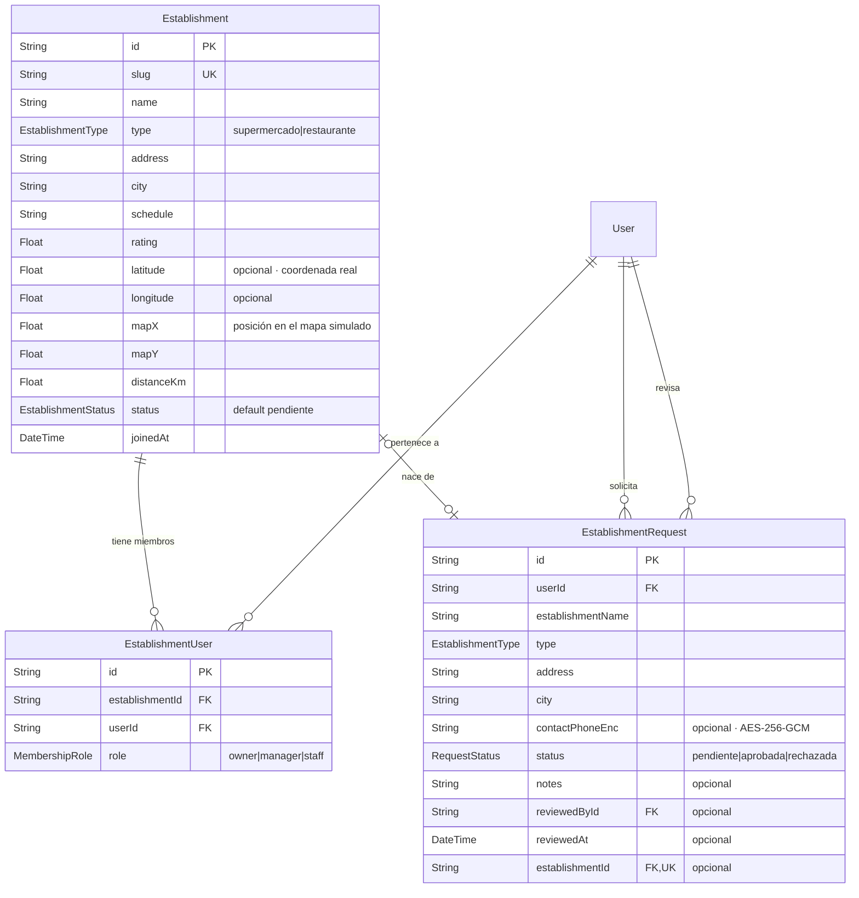
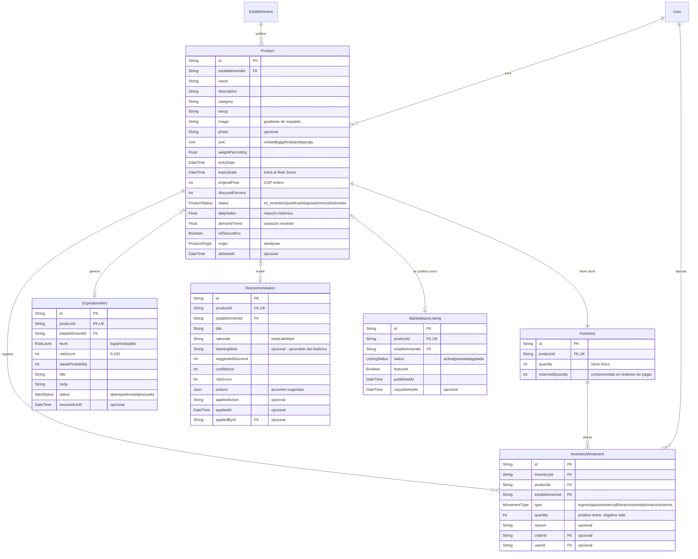
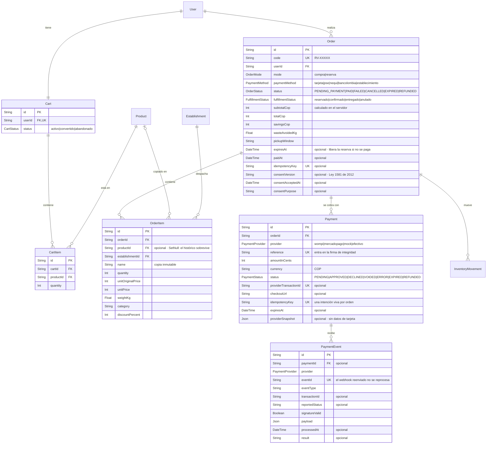
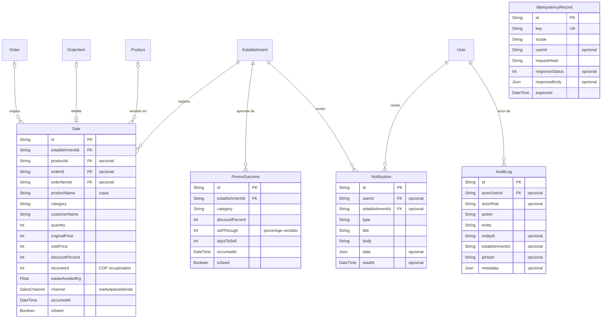
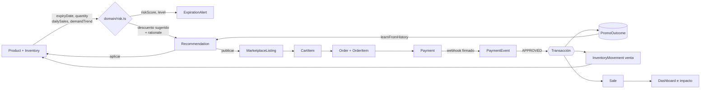

# Modelo de datos (DER)

- **Motor:** **PostgreSQL 16** (`provider = "postgresql"` en `server/prisma/schema.prisma`).
  En desarrollo corre en Docker (`docker compose up -d db`, puerto **5433**); las
  pruebas usan una base aparte en `tmpfs` (puerto **5434**).
- **ORM y migraciones:** Prisma 6.19. El esquema es la fuente de verdad y las
  migraciones están versionadas en `server/prisma/migrations/`.
- **Tamaño:** **27 modelos** y **22 enumeraciones**.
- `TODO:` definir el proveedor de base de datos gestionada para producción
  (Neon, Supabase, RDS, Railway…). Hoy solo existe la de desarrollo.

## Convenciones

| Convención | Regla |
|---|---|
| Identificadores | `uuid` generado por la base (`@default(uuid())`) |
| Dinero | **Enteros en COP.** El peso colombiano no usa decimales. A la pasarela va en centavos (`amountInCents`) |
| Multi-tenant | Toda entidad de negocio lleva `establishmentId` indexado |
| Borrado | **Lógico** donde hay histórico que preservar (`deletedAt` en `User` y `Product`) |
| Datos personales recuperables | Cifrados con **AES-256-GCM** (`phoneEncrypted`, `documentEncrypted`, `contactPhoneEnc`) |
| Contraseñas | **Argon2id**, nunca cifrado reversible |
| Tokens (sesión, verificación) | Se guarda el **hash SHA-256**; el valor en claro solo vive en la cookie o en el correo |
| IP | Se guarda `ipHash` con sal (`IP_HASH_SALT`), nunca la IP en claro |
| Fechas | `DateTime` en UTC; la presentación usa `America/Bogota` |
| Payloads de terceros | Columnas `Json` (`providerSnapshot`, `payload`, `metadata`, `actions`) |

---

## 1 · Identidad, roles y sesiones

```mermaid
erDiagram
    Role ||--o{ RolePermission : "otorga"
    Permission ||--o{ RolePermission : "pertenece a"
    User ||--o{ Session : "abre"
    User ||--o{ VerificationToken : "recibe"
    User ||--o{ EstablishmentUser : "es miembro de"
    User ||--o{ AuditLog : "genera"

    Role {
        UserRole code PK "supermercado|restaurante|cliente|superadmin"
        String name
        String description
    }
    Permission {
        String code PK "ej. products:write"
        String description
    }
    RolePermission {
        UserRole roleCode PK, FK
        String permissionCode PK, FK
    }
    User {
        String id PK
        String email UK
        String name
        String passwordHash "Argon2id"
        UserRole role "default cliente"
        UserStatus status "activo|pendiente|suspendido"
        DateTime emailVerifiedAt "opcional"
        String phoneEncrypted "opcional · AES-256-GCM"
        String documentEncrypted "opcional · AES-256-GCM"
        Boolean isDemo
        Int failedLogins "bloqueo por fuerza bruta"
        DateTime lockedUntil "opcional"
        DateTime lastLoginAt "opcional"
        DateTime deletedAt "opcional · baja lógica"
    }
    Session {
        String id PK
        String userId FK
        String tokenHash UK "SHA-256 del token opaco"
        DateTime expiresAt
        DateTime revokedAt "opcional"
        String ipHash "opcional"
        String userAgent "opcional"
    }
    VerificationToken {
        String id PK
        String userId FK
        TokenPurpose purpose "email_verification|password_reset"
        String tokenHash UK
        DateTime expiresAt
        DateTime usedAt "opcional · un solo uso"
    }
    LoginAttempt {
        String id PK
        String email
        String ipHash
        Boolean success
        DateTime createdAt
    }
```



`LoginAttempt` no tiene relación con `User` a propósito: registra también los
intentos con correos que no existen, sin revelar si la cuenta existe.

---

## 2 · Establecimientos



> **El rol nunca se autoasigna.** Quien se registra entra como `cliente`; para
> operar un establecimiento hace falta una `EstablishmentRequest` aprobada por un
> superadministrador, que crea el establecimiento, la membresía `owner` y cambia
> el rol en una sola transacción.

---

## 3 · Productos, inventario e inteligencia



**Por qué `Inventory` está separado de `Product`:** el stock es la fila que más
cambia y la que hay que bloquear en las compras simultáneas. Separarla permite
tomar el bloqueo sobre una sola fila estrecha sin congelar el producto completo.
Es lo que verifica `server/src/tests/concurrency.test.ts`.

---

## 4 · Carrito, órdenes y pagos



### Dos estados independientes, a propósito

`OrderStatus` es el **ciclo del dinero** (fuente de verdad del cobro) y
`FulfillmentStatus` el **ciclo logístico** (lo que ve la persona). Una reserva
pagada en el local está `PENDING_PAYMENT` + `reservado`; al recoger y pagar pasa a
`PAID` + `entregado`. Mezclarlos en un solo campo obligaría a inventar estados
como «reservado-pendiente-de-pago-pero-confirmado».

### Tres barreras contra el doble cobro

| Barrera | Restricción | Qué evita |
|---|---|---|
| Orden duplicada | `Order.idempotencyKey` único | Doble clic en «Pagar» |
| Intención de pago duplicada | `Payment.idempotencyKey` único | Dos checkouts vivos para la misma orden |
| Webhook reenviado | `PaymentEvent.eventId` único | Mover inventario o confirmar dos veces |

Además `IdempotencyRecord` guarda la respuesta completa por clave, así que el
reintento del cliente recibe **la misma respuesta** y no un conflicto.

---

## 5 · Ventas, aprendizaje y operación



**`PromoOutcome` es la memoria del motor de recomendaciones.** Cada venta de un
producto con descuento deja un registro (categoría, descuento, % de inventario
vendido, días hasta agotarse) y `learnFromHistory()` busca ahí el descuento con
mejor relación entre venta y margen para esa categoría. Por eso las
recomendaciones cambian a medida que se usa el sistema.

**`isSeed`** separa los datos de demostración de los reales: permite reiniciar la
demo sin borrar lo que generó una persona.

---

## 6 · El ciclo del dato, de punta a punta



Todo lo que ocurre tras un pago aprobado pasa en **una sola transacción**:
descontar stock, registrar el movimiento, escribir la venta y guardar el
resultado de la promoción. O todo, o nada.

---

## Migraciones

| Migración | Qué trae |
|---|---|
| `20261103184359_init_reverde` | Esquema completo inicial (812 líneas de SQL) |
| `20261103213844_order_consent` | `consentVersion`, `consentAcceptedAt` y `consentPurpose` en `Order` — prueba de la autorización de tratamiento de datos |

```bash
npm run db:migrate   # crea y aplica una migración en desarrollo
npm run db:deploy    # aplica las pendientes (producción, idempotente)
npm run db:reset     # borra y vuelve a sembrar (solo desarrollo)
npm run db:studio    # explorador visual de Prisma
```

## Pendientes del modelo

| # | Pendiente | Por qué importa |
|---|---|---|
| D1 | `TODO:` proveedor de base de datos gestionada para producción | Sin esto no hay despliegue de la API |
| D2 | Índice para búsqueda de texto en `Product.name` | Hoy el marketplace filtra con `contains`; con catálogos grandes conviene `pg_trgm` o `tsvector` |
| D3 | `TODO:` política de retención en base de datos | `data/legal.ts` declara 24 meses, pero no hay trabajo que borre lo vencido |
| D4 | Particionar o archivar `AuditLog` y `PaymentEvent` | Crecen de forma indefinida |
| D5 | `latitude`/`longitude` están sin usar | El mapa es simulado (`mapX`/`mapY`); si se adopta geolocalización real, migrar y agregar índice geoespacial |
