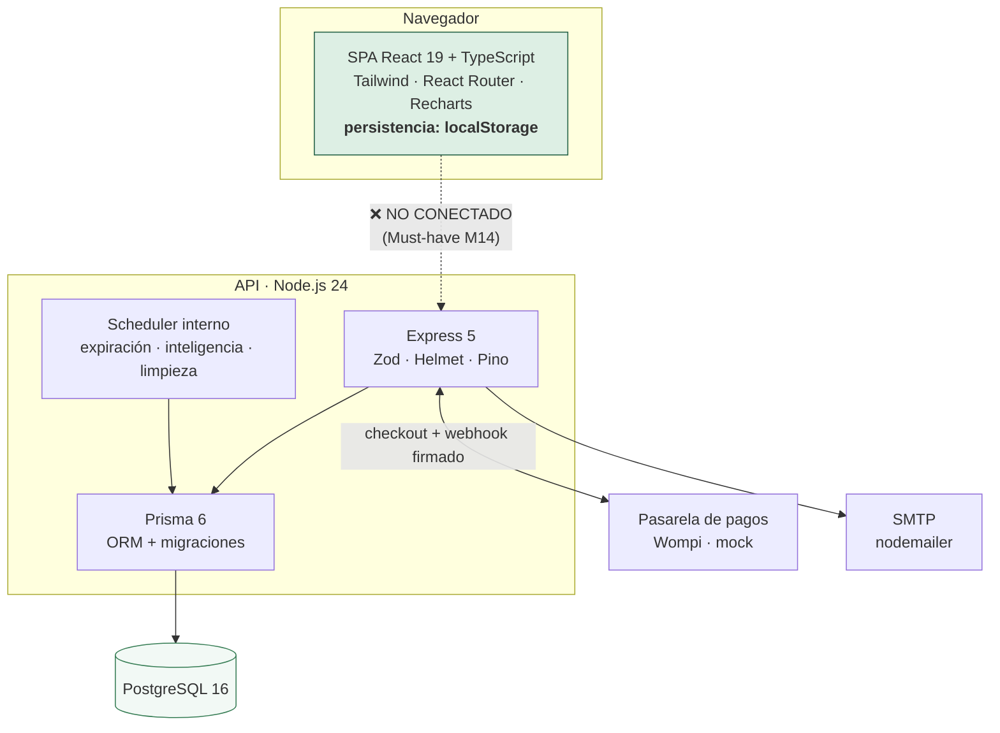

# Stack tecnológico

Lo que está instalado, por qué, y qué se descartó. Las versiones son las de
`package.json` y `server/package.json` a la fecha de este documento.

## Visión general

> **Lo primero que hay que saber del stack:** la SPA y la API **no están
> conectadas todavía**. La SPA persiste en `localStorage` y la API en
> PostgreSQL. Es el Must-have M14 de [`mvp-moscow.md`](../estrategia/mvp-moscow.md)
> y el riesgo técnico principal del proyecto.

## Frontend

| Tecnología | Versión | Por qué esta |
|---|---|---|
| **React** | 19.2 | El equipo ya la conoce; el modelo de componentes encaja con una interfaz de paneles y listas. React 19 permite `use`/transiciones si más adelante se consume la API |
| **TypeScript** | ~6.0, modo estricto | El dominio tiene muchos estados (`OrderStatus`, `RiskLevel`, `ProductStatus`); los tipos literales evitan estados imposibles en tiempo de compilación |
| **Vite** | 8.3 | Arranque y HMR instantáneos. Build de producción en < 1 s |
| **Tailwind CSS** | 3.4 | Sin hojas de estilo paralelas; los tokens de diseño se definen una vez en `design.tokens.mjs` y la consistencia se vuelve el camino fácil |
| **React Router** | 7.18 | Rutas anidadas por rol y protección por guarda (`RequireRole`) |
| **Recharts** | 3.10 | Gráficas declarativas en React, sin envoltorio sobre D3 escrito a mano |
| **lucide-react** | 1.47 | Juego de iconos coherente y *tree-shakeable* |

### Decisiones del frontend

- **SPA, no SSR.** La aplicación es un panel detrás de autenticación: el SEO no
  aporta y el renderizado en servidor añadiría complejidad sin beneficio. La
  landing es la única pantalla pública y es ligera.
- **Estado en Context, sin Redux ni Zustand.** `AppContext` + `ConsentContext`
  bastan: un solo usuario por sesión y un árbol de estado pequeño.
- **Sin librería de componentes** (MUI, Chakra, shadcn). Se construyó un juego
  propio (`src/components/ui/`) para que la identidad de marca no pelee con los
  estilos de un tercero. Coste: mantenerlo; ver [`../diseno/ui-kit.md`](../diseno/ui-kit.md).
- **Fotografías locales** (`public/img/productos/`, ≈ 840 KB, CC0): la demo
  funciona **sin internet**.

## Backend

| Tecnología | Versión | Por qué esta |
|---|---|---|
| **Node.js** | 24 LTS (`server/Dockerfile`) | Mismo lenguaje que el frontend: un solo juego de tipos del dominio y una sola curva de aprendizaje para 4 personas |
| **Express** | 5.3 | Minimalista y conocido. La versión 5 maneja `async` sin envoltorios y ya es estable |
| **Prisma** | 6.19 | Esquema declarativo, migraciones versionadas y cliente con tipos generados. El esquema es además la documentación del modelo de datos |
| **PostgreSQL** | 16 | Transacciones serias para el movimiento de inventario y dinero, `JSONB` para payloads de pasarela, y restricciones únicas para la idempotencia |
| **Zod** | 4.6 | Validación de **toda** entrada en el borde, con el tipo inferido del esquema |
| **@node-rs/argon2** | 2.2 | **Argon2id** para contraseñas: implementación nativa en Rust, más rápida que la de JS |
| **Helmet** | 8.3 | Cabeceras de seguridad, HSTS en producción |
| **Pino** + `pino-http` | 10 / 11 | Logging estructurado en JSON con `requestId` por petición |
| **nodemailer** | 10.3 | Envío de correo con dos transportes: `log` en desarrollo, SMTP en producción |
| **swagger-ui-express** | 5.0 | Documentación interactiva en `/api/docs` |
| **dotenv** | 18 | Carga por ambiente con precedencia explícita |

### Decisiones del backend

- **Express en lugar de NestJS o Fastify.** El equipo es de 4 personas y el
  proyecto tiene 15 módulos: la estructura por carpetas
  (`modules/<dominio>/{routes,service,schemas}.ts`) da el orden que haría falta
  sin el coste de aprender un framework con decoradores e inyección.
- **Prisma en lugar de SQL a mano o TypeORM.** Las migraciones versionadas y el
  cliente tipado valen el coste de la capa. Donde Prisma no alcanza —bloqueos de
  fila para el stock— se usa SQL crudo dentro de la transacción.
- **La app se exporta sin arrancar** (`createApp()` en `app.ts`): las pruebas la
  montan con `supertest` sin abrir un puerto.
- **Trabajos periódicos dentro del proceso** (`scheduler.ts`). Son cortos e
  idempotentes. `TODO:` con varias réplicas hay que moverlos a un cron externo
  para no duplicar trabajo (está anotado en el propio archivo).
- **El dinero son enteros en COP.** El peso colombiano no tiene decimales; a la
  pasarela va en centavos (`amountInCents`). Nunca hay números de punto flotante
  en montos.
- **Pagos detrás de una interfaz** (`PaymentProviderAdapter`): cambiar de
  proveedor es implementar un adaptador, no tocar el dominio.

## Base de datos

**PostgreSQL 16** (ver [`modelo-datos.md`](./modelo-datos.md)). Lo que decidió la
elección:

| Necesidad | Qué se usa |
|---|---|
| El stock no puede quedar en negativo con compras simultáneas | Transacciones con bloqueo de fila sobre `Inventory` |
| Un webhook reenviado no debe cobrar dos veces | `@unique` sobre `PaymentEvent.eventId` |
| Un doble clic en «Pagar» no debe crear dos órdenes | `@unique` sobre `Order.idempotencyKey` y `IdempotencyRecord.key` |
| Guardar el payload del proveedor sin esquema fijo | Columnas `Json` (`providerSnapshot`, `payload`, `metadata`) |
| Aislar los datos de cada establecimiento | `establishmentId` indexado en toda entidad de negocio |

## Pruebas

| Herramienta | Versión | Qué cubre |
|---|---|---|
| **Vitest** | 5.1 | Unitarias del frontend (jsdom) y de integración de la API (node) |
| **@testing-library/react** | 16.3 | Pruebas que montan los providers reales, sin dobles del store |
| **supertest** | 7.3 | Pruebas de la API sobre la app de Express, sin abrir puerto |
| **Playwright** | 1.64 | QA end-to-end en navegador real, escritorio y móvil |
| **autocannon** | 8.0 | Carga HTTP sobre el build de producción |
| **k6** | externo | Perfiles de humo, carga, pico y estrés |
| **oxlint** | 1.81 | Linter en Rust: corre en milisegundos, por eso se puede exigir en cada commit |

Detalle en [`../TESTING.md`](../TESTING.md) y [`../qa/interfaz.md`](../qa/interfaz.md).

## Infraestructura y herramientas

| Pieza | Qué es | Dónde |
|---|---|---|
| **npm workspaces** | Monorepo: raíz = SPA, `server/` = API. Un `package-lock.json`, una instalación | `package.json` |
| **Docker Compose** | PostgreSQL de desarrollo (5433), de pruebas en tmpfs (5434) y la API con perfil `full` | `docker-compose.yml` |
| **Dockerfile multi-stage** | Imagen de producción de la API; aplica migraciones al arrancar | `server/Dockerfile` |
| **Vercel** | Despliegue de la SPA (proyecto `reverde` ya enlazado) | `vercel.json` · `.vercel/` |
| **GitHub Actions** | CI: lint, typecheck, pruebas, build | `.github/workflows/` |
| **Destino de la API** | `TODO:` **sin decidir.** Candidatos: Render, Railway, Fly.io o una VM. Hay Dockerfile, así que cualquiera sirve | — |
| **Base de datos gestionada** | `TODO:` **sin decidir** para producción | — |

## Versiones de runtime

| | Versión | Dónde está fijada |
|---|---|---|
| Node.js (API en producción) | 24 LTS | `server/Dockerfile` |
| Node.js (CI) | 24 | `.github/workflows/ci.yml` |
| Node.js (desarrollo local) | `TODO:` añadir `.nvmrc` para igualar a las demás | — |
| PostgreSQL | 16 | `docker-compose.yml` |

## Lo que se descartó, y por qué

| Alternativa | Por qué no |
|---|---|
| Next.js | No hay necesidad de SSR/SSG: todo está detrás de autenticación. Añadiría un modelo de renderizado extra que mantener |
| NestJS | Demasiada estructura para 4 personas y 15 módulos |
| MongoDB | El dominio es relacional (órdenes, ítems, pagos, movimientos) y necesita transacciones multi-tabla |
| Firebase / Supabase | La lógica de riesgo, idempotencia y reserva de stock vive en el servidor; ir sin backend obligaría a meterla en el cliente, donde no se puede confiar en ella |
| bcrypt | Argon2id es la recomendación vigente de OWASP para contraseñas nuevas |
| JWT en `localStorage` | Vulnerable a XSS y no se puede revocar. Se usa sesión opaca en cookie `HttpOnly` con su hash en base de datos, revocable |
| Stripe | No cubre PSE ni Nequi, que son los medios de pago del mercado colombiano |
| ESLint | oxlint hace lo mismo en una fracción del tiempo. `TODO:` revisar si falta alguna regla de tipos que oxlint no cubra |
