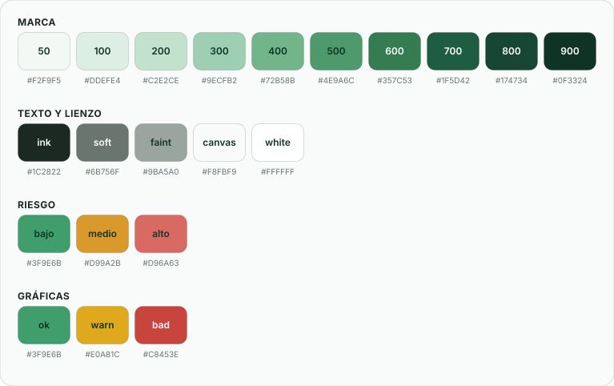

# UI Kit · guía de estilos de Reverde

Los valores de esta guía **no están escritos aquí**: viven en
[`design.tokens.mjs`](../../design.tokens.mjs), que es la única fuente de verdad.
`tailwind.config.js` los consume para generar las clases de utilidad y
`src/index.css` los replica como variables CSS para lo que queda fuera de
Tailwind (SVG en línea, estilos calculados en JS, plantillas de correo).

```
design.tokens.mjs ──► tailwind.config.js ──► clases (bg-brand-700, text-body…)
        └───────────► src/index.css ───────► variables (--brand-700, --ease-brand…)
```

> Al cambiar un color o una medida, cámbialo en `design.tokens.mjs` **y** en el
> bloque `:root` de `src/index.css`. Son dos lugares a propósito: el CSS no puede
> importar un módulo de JavaScript en tiempo de ejecución.

---

## 1 · Color



> Las muestras de esta sección son SVG generados desde `design.tokens.mjs` con
> `npm run docs:swatches` y versionados en [`swatches/`](swatches/). Al cambiar
> un color, vuelve a ejecutar el script: el chip de la tabla y la lámina de
> arriba se repintan solos y nunca quedan mintiendo sobre el valor real.

### Marca

| Muestra | Token | Clase | Hex | Uso |
|---|---|---|---|---|
|  | `brand.50` | `bg-brand-50` | `#F2F9F5` | Fondos de hover muy suaves, *skeletons* |
|  | `brand.100` | `bg-brand-100` | `#DDEFE4` | Superficies suaves, botón secundario, selección de texto |
|  | `brand.200` | `bg-brand-200` | `#C2E2CE` | Bordes activos, barra de desplazamiento, anillo de foco |
|  | `brand.300` | `bg-brand-300` | `#9ECFB2` | Borde de hover |
|  | `brand.400` | `bg-brand-400` | `#72B58B` | **Verde secundario** · acentos, borde de foco |
|  | `brand.500` | `bg-brand-500` | `#4E9A6C` | Acentos medios |
|  | `brand.600` | `bg-brand-600` | `#357C53` | Intermedio |
|  | `brand.700` | `bg-brand-700` | `#1F5D42` | **Verde principal** · marca y acciones primarias |
|  | `brand.800` | `bg-brand-800` | `#174734` | Hover de la acción primaria |
|  | `brand.900` | `bg-brand-900` | `#0F3324` | Estado activo (presionado) |

### Texto y lienzo

| Muestra | Token | Clase | Hex | Uso |
|---|---|---|---|---|
|  | `ink` | `text-ink` | `#1C2822` | Titulares y cuerpo |
|  | `ink.soft` | `text-ink-soft` | `#6B756F` | Texto de apoyo, etiquetas |
|  | `ink.faint` | `text-ink-faint` | `#9BA5A0` | Placeholders, ejes de gráficas |
|  | `canvas` | `bg-canvas` | `#F8FBF9` | Fondo de la aplicación |
|  | — | `bg-white` | `#FFFFFF` | Superficie de tarjetas y campos |

### Riesgo

| Muestra | Nivel | Token | Hex | Significado |
|---|---|---|---|---|
|  | Bajo | `risk.low` | `#3F9E6B` | Score 0–39 |
|  | Medio | `risk.mid` | `#D99A2B` | Score 40–69 |
|  | Alto | `risk.high` | `#D96A63` | Score 70–100 |

### Gráficas

Serie validada por separación cromática bajo daltonismo
(expuesta también como `RISK_COLORS` en `src/components/charts/Charts.tsx`):

| Muestra | Token | Hex | Serie |
|---|---|---|---|
|  | `chart.ok` | `#3F9E6B` | `RISK_COLORS.bajo` · score 0–39 |
|  | `chart.warn` | `#E0A81C` | `RISK_COLORS.medio` · score 40–69 |
|  | `chart.bad` | `#C8453E` | `RISK_COLORS.alto` · score 70–100 |

### Regla de accesibilidad · no negociable

> **El color nunca es la única señal.** Todo indicador de riesgo lleva, además
> del color, **texto** («Alto») y un **icono** (`AlertTriangle`, `CircleAlert`,
> `CheckCircle2`). Ver `RiskBadge` en `src/components/ui/Badge.tsx`.

Contraste objetivo: **WCAG 2.1 AA** — 4.5:1 en texto normal, 3:1 en texto grande
y en elementos de interfaz.
`TODO:` falta una auditoría de contraste con herramienta (axe / Lighthouse) que
verifique cada combinación; hoy la afirmación está sin medir.

---

## 2 · Tipografía

Familia única: **Inter**, con respaldo del sistema
(`SF Pro Display`, `-apple-system`, `BlinkMacSystemFont`, `Segoe UI`, `sans-serif`).
Los titulares llevan `tracking-[-0.02em]`, aplicado en `src/index.css` a
`h1`–`h4`.

| Token | Clase | Tamaño | Interlínea | Uso |
|---|---|---|---|---|
| `display-lg` | `text-display-lg` | 2,5 rem | 1,1 | Titular de la landing |
| `display` | `text-display` | 2 rem | 1,15 | Titular de pantalla |
| `title-lg` | `text-title-lg` | 1,5 rem | 1,25 | Título de sección |
| `title` | `text-title` | 1,25 rem | 1,3 | Título de tarjeta |
| `body-lg` | `text-body-lg` | 1 rem | 1,6 | Cuerpo destacado |
| `body` | `text-body` | 0,875 rem | 1,6 | Cuerpo por defecto |
| `caption` | `text-caption` | 0,8125 rem | 1,5 | Etiquetas, metadatos |
| `micro` | `text-micro` | 0,75 rem | 1,4 | Insignias, pies |

La escala por defecto de Tailwind (`text-sm`, `text-base`…) sigue disponible y
es la que usa la mayoría del código existente; los tokens de arriba son la
escala **a la que converger** en pantallas nuevas.

Pesos en uso: 400 (cuerpo) · 500 (etiquetas) · 600 (metadatos, insignias) ·
700 (titulares) · 800 (cifras de KPI).

---

## 3 · Espaciado y medidas

Base de 4 px (escala por defecto de Tailwind: `p-1` = 4 px). A eso se suman los
tokens semánticos:

| Token | Clase | Valor | Uso |
|---|---|---|---|
| `gutter` | `px-gutter` | 1 rem | Margen lateral en móvil |
| `gutter-lg` | `px-gutter-lg` | 1,5 rem | Margen lateral en escritorio |
| `section` | `gap-section` | 2 rem | Separación entre bloques |
| `section-lg` | `gap-section-lg` | 3 rem | Separación amplia |
| `sidebar` | `w-sidebar` | 15 rem | Ancho de la barra lateral |
| `nav-mobile` | `h-nav-mobile` | 4,25 rem | Alto de la navegación inferior |
| `field` | `min-h-field` | 2,75 rem (44 px) | **Mínimo táctil**: ningún control interactivo debe ser menor |
| `safe-top` | `pt-safe-top` · `.safe-top` | `env(safe-area-inset-top)` | Isla dinámica y barra de estado |
| `safe-bottom` | `pb-safe-bottom` · `.safe-bottom` | `env(safe-area-inset-bottom)` | Indicador de inicio del iPhone |
| `safe-left` / `safe-right` | `.safe-x` | `env(safe-area-inset-*)` | Muesca lateral en horizontal |
| `nav-safe` | `pb-nav-safe` | `nav-mobile + safe-bottom + 0,75 rem` | Espacio que el contenido deja sobre la barra inferior |

### Radios

`rounded-[10px]` botón `sm` · `rounded-xl` 14 px (campos, botón `md`) ·
`rounded-2xl` 20 px (tarjetas, botón `lg`) · `rounded-3xl` 28 px (superficies
grandes) · `rounded-full` (insignias y chips).

### Sombras

| Token | Clase | Uso |
|---|---|---|
| `soft` | `shadow-soft` | Tarjeta en reposo |
| `lift` | `shadow-lift` | Tarjeta en hover, modal |
| `glow` | `shadow-glow` | Acción primaria (verde) |

### Puntos de quiebre

`sm` 640 · **`md` 768 — el corte real del producto: debajo es la experiencia
móvil, encima la de escritorio** · `lg` 1024 · `xl` 1280.

### Móvil primero

El producto se usa desde el teléfono —la tienda casi en exclusiva—, así que
estas reglas son del sistema, no de cada pantalla. Las tres primeras están
verificadas por pruebas de QA en los tres perfiles móviles
([`tests/qa/resilience.spec.ts`](../../tests/qa/resilience.spec.ts)).

| Regla | Por qué | Cómo se cumple |
|---|---|---|
| **Ningún control por debajo de 44 px** en móvil | Guía de interfaz de Apple; por debajo se falla el toque | `min-h-field` en botones, chips, segmentados e interruptores; los iconos van en caja de 44 y se compactan desde `sm` |
| **Los campos miden 16 px de letra** en móvil | Por debajo, Safari en iPhone hace zoom al enfocar y descuadra la página | `.input-base` usa `text-base` y vuelve a `text-sm` desde `sm` |
| **Nada desborda a lo ancho** | Un scroll horizontal accidental rompe la lectura | Toda pista de grid lleva `minmax(0,…)`; los carriles usan `.rail`, que sí desborda a propósito |
| **Zonas seguras** | En un iPhone el contenido quedaría bajo la isla dinámica o el indicador de inicio | `.safe-top`, `.safe-x`, `.safe-bottom` en cabeceras, barras y hojas; el contenido reserva `pb-nav-safe` |
| **Alto de ventana con `dvh`** | `100vh` en iOS mide con la barra del navegador retraída y corta el final | `.min-h-app` (`100dvh`, con `100vh` de respaldo) |
| **Carriles horizontales con el pulgar** | Los filtros y las tarjetas se recorren deslizando | `.rail`: inercia, imán al soltar y extremos alineados con el margen |
| **Se respeta «reducir movimiento»** | Es un ajuste de accesibilidad frecuente en iOS | `@media (prefers-reduced-motion: reduce)` apaga animaciones y transiciones |
| **Sin zoom por pellizco ni por doble toque** | En el mapa, pellizcar alejaba la aplicación entera en vez de mover el mapa | Tres capas: la etiqueta `viewport` (Android), `touch-action: pan-x pan-y` (Chrome, doble toque) y [`src/lib/viewport.ts`](../../src/lib/viewport.ts) (los `gesture*` de Safari, que ignora las otras dos) |

Para probar desde un teléfono real en la misma red: `npm run dev:movil` y abrir
en el teléfono la dirección `Network` que imprime Vite.

---

## 4 · Movimiento

Una sola curva en toda la aplicación: `cubic-bezier(.22,1,.36,1)`
(`ease-brand`, o `var(--ease-brand)`).

| Duración | Token | Uso |
|---|---|---|
| 0,2 s | `--duration-fast` | Hover, cambio de color, foco |
| 0,3 s | `--duration-base` | Entrada de hoja inferior, transición de panel |
| 0,45 s | `--duration-slow` | Entrada de contenido (`fade-up`) |

Animaciones disponibles: `animate-fade-up` · `animate-fade-in` ·
`animate-scale-in` (modales) · `animate-slide-up` (hojas inferiores) ·
`animate-pulse-ring` (alerta de riesgo alto).

**`prefers-reduced-motion` se respeta** (`src/index.css`): si la persona pidió
reducir el movimiento en su sistema —en iOS, Ajustes › Accesibilidad ›
Movimiento— ninguna animación ni transición se ejecuta. Los cambios de estado
siguen ocurriendo, pero sin desplazamientos ni rebotes.

---

## 5 · Componentes base

Todos viven en `src/components/ui/` y son los que debe usar cualquier pantalla
nueva. **No se crean variantes nuevas de color o tamaño por fuera de estas.**

### `Button` · `src/components/ui/Button.tsx`

```tsx
<Button variant="primary" size="md" icon={<Plus />}>Registrar producto</Button>
<Button variant="outline" to="/app/alertas">Ver alertas</Button>   {/* renderiza <Link> */}
<IconButton aria-label="Cerrar"><X /></IconButton>
```

| Variante | Apariencia | Cuándo |
|---|---|---|
| `primary` | Verde 700, sombra `glow` | La acción principal de la pantalla. **Una sola por vista** |
| `secondary` | Verde 100 sobre texto verde 700 | Acción alterna frecuente |
| `outline` | Blanco con borde | Acción neutra, navegación |
| `ghost` | Sin fondo | Acción terciaria, barras de herramientas |
| `danger` | Rojo suave | Eliminar, dar de baja, anular |
| `light` | Blanco translúcido con *backdrop blur* | Sobre fondo verde o fotografía |

Tamaños: `sm` 36 px · `md` 44 px (por defecto) · `lg` 52 px.
Todos traen `focus-visible:ring-4 ring-brand-200` y `active:scale-[.97]`.
`to` convierte el botón en enlace de React Router sin cambiar la apariencia.

### `Badge` · insignias

```tsx
<Badge tone="brand">Publicado</Badge>
<RiskBadge level="alto" />          {/* color + texto + icono, siempre los tres */}
<DiscountTag percent={30} />
```

Tonos: `neutral` · `brand` · `amber` · `red` · `green` · `dark`.

### `Field` y controles de formulario

```tsx
<Field label="Nombre del producto" hint="Como aparece en la góndola" error={error}>
  <Input value={name} onChange={…} />
</Field>
<Select …/> <Textarea …/> <SearchInput …/> <Segmented …/> <Toggle …/> <Checkbox …/>
```

`Field` asocia la etiqueta con el control y muestra la ayuda y el error.
`TODO:` el hallazgo **H-2** de [`../QA-PLAN.md`](../QA-PLAN.md) señala que algunos
campos no tienen `label` asociada. Usar siempre `Field` cierra ese hallazgo.

### `Modal` y `Drawer`

`Modal` centrado en escritorio; `Drawer` como hoja inferior en móvil. Ambos
atrapan el foco y cierran con `Esc`. Toda confirmación destructiva va en `Modal`.

### Primitivas · `src/components/ui/Primitives.tsx`

| Componente | Para qué |
|---|---|
| `Card` | Superficie base: blanco, `rounded-2xl`, borde `black/5`, `shadow-soft` |
| `SectionTitle` | Encabezado de sección con acción opcional a la derecha |
| `KpiCard` | Cifra grande + etiqueta + variación |
| `EmptyState` | Vacío con icono, explicación y salida (nunca una lista vacía a secas) |
| `Avatar` | Inicial sobre color derivado de `avatarHue` |
| `ProgressBar` | Avance y peso de los factores de riesgo |
| `ScoreRing` | Anillo del Risk Score 0–100 |
| `ProductThumb` | Foto 4:3 con respaldo al gradiente de categoría + emoji |
| `Divider` | Separador |

### `Toaster` · avisos

Un único `<Toaster />` montado en `App.tsx`; los avisos se emiten desde el store
(`useApp().toast(...)`). Toda acción que cambia datos **confirma con un aviso**.

### Gráficas · `src/components/charts/Charts.tsx`

`ChartCard` · `AreaTrend` · `BarTrend` · `LineTrend` · `RiskDistribution` ·
`CategoryRiskChart` · `Sparkline`.

Reglas: **una serie por gráfica** (nunca dos escalas en el mismo eje), ejes sin
línea ni marcas, rejilla al 7 % de opacidad, y el nivel de riesgo siempre
etiquetado además de coloreado.

### Marca · `src/components/Logo.tsx`

`<Logo />` (logotipo con texto) · `<Logo tone="light" />` (sobre fondo verde) ·
`<ReverdeMark />` (solo isotipo).
Concepto: una **hoja** inscrita en dos **flechas circulares** — frescura y
segunda oportunidad.

---

## 6 · Reglas de composición

1. **Una sola acción `primary` por pantalla.** Si hay dos acciones igual de importantes, el diseño está mal planteado.
2. **Toda lista vacía usa `EmptyState`** con una salida clara.
3. **Toda cifra de dinero pasa por `formatCOP`** (`src/lib/format.ts`): el peso colombiano no lleva decimales.
4. **Toda acción que cambia datos confirma con un aviso** del `Toaster`.
5. **Toda acción destructiva confirma en un `Modal`** antes de ejecutarse.
6. **Ningún control interactivo mide menos de 44 px** de lado (`min-h-field`).
7. **El riesgo se comunica con color + texto + icono.** Siempre los tres.
8. **El administrador conserva sus funciones en móvil**: tabla → tarjetas, filtros → panel, pero nada desaparece (salvo `/app/ventas`, oculta del nav móvil a propósito).
9. **Las fotografías van en 4:3** (720 × 540) con respaldo al gradiente de categoría.
10. **No se introduce un color, un radio ni una sombra que no esté en los tokens.**

---

## 7 · Pendientes del UI Kit

| # | Pendiente | Impacto |
|---|---|---|
| U1 | `TODO:` auditoría de contraste con axe o Lighthouse | Accesibilidad: la conformidad AA está afirmada, no medida |
| ~~U2~~ | ~~`prefers-reduced-motion`~~ | — | ✅ **Cerrado**: bloque `@media (prefers-reduced-motion: reduce)` en `src/index.css` |
| U3 | Cerrar el hallazgo H-2 (campos sin `label`) usando `Field` en todas las pantallas | Accesibilidad |
| U4 | `TODO:` ¿vale la pena un Storybook? Hoy los componentes solo se ven dentro de la app | Velocidad de diseño |
| U5 | Migrar las pantallas existentes a los tokens tipográficos (`text-body`…) | Consistencia |
| U6 | `TODO:` decidir si habrá tema oscuro. Hoy la paleta es solo clara | Alcance |
