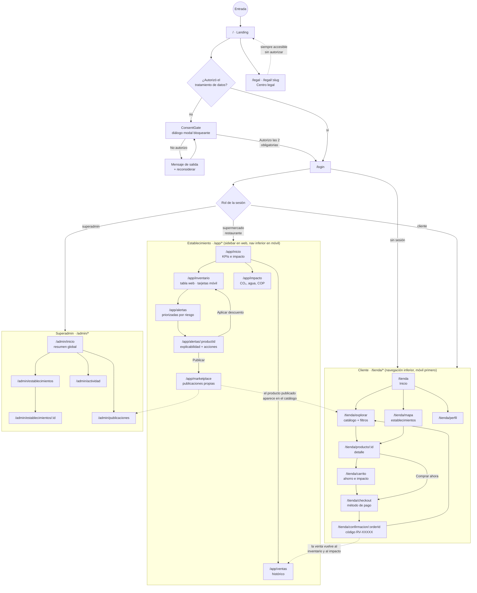
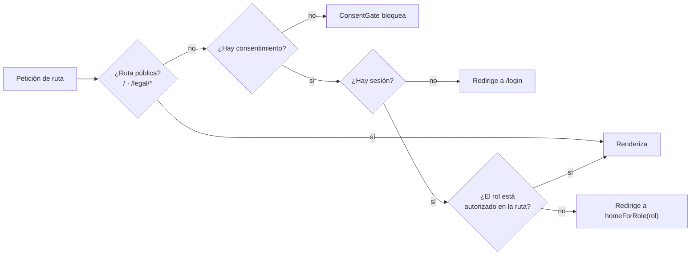
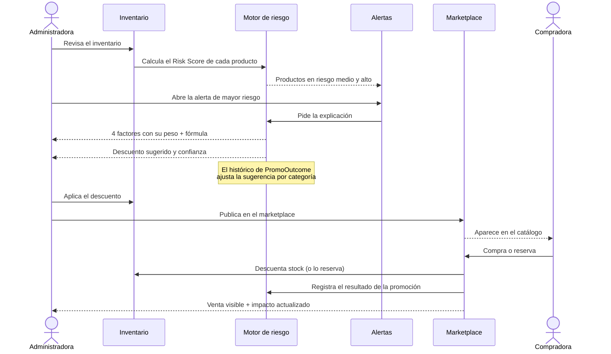
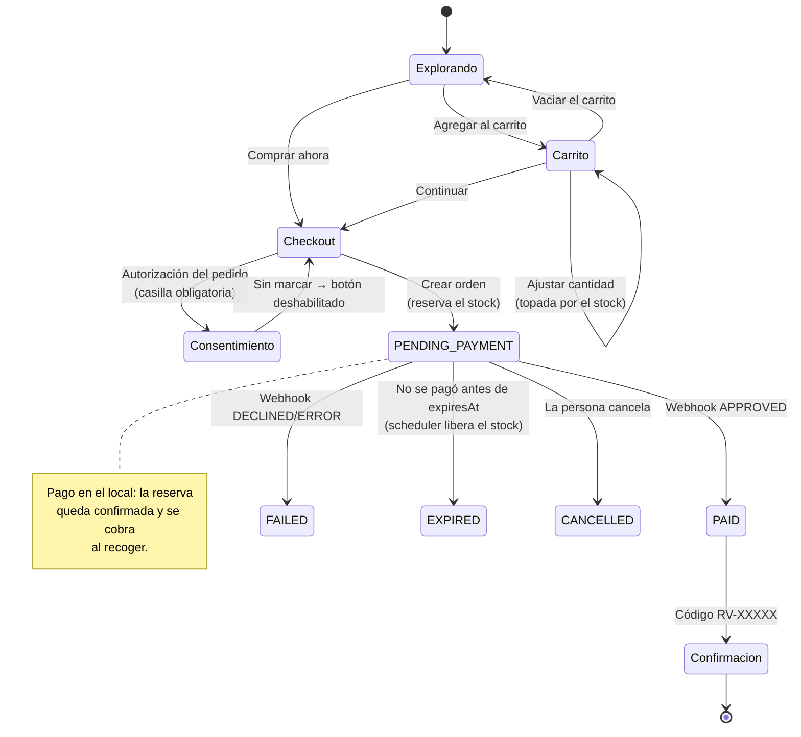
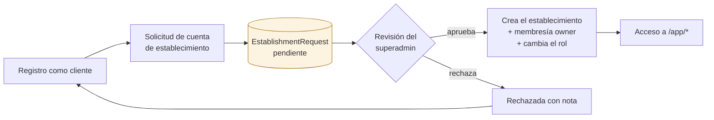
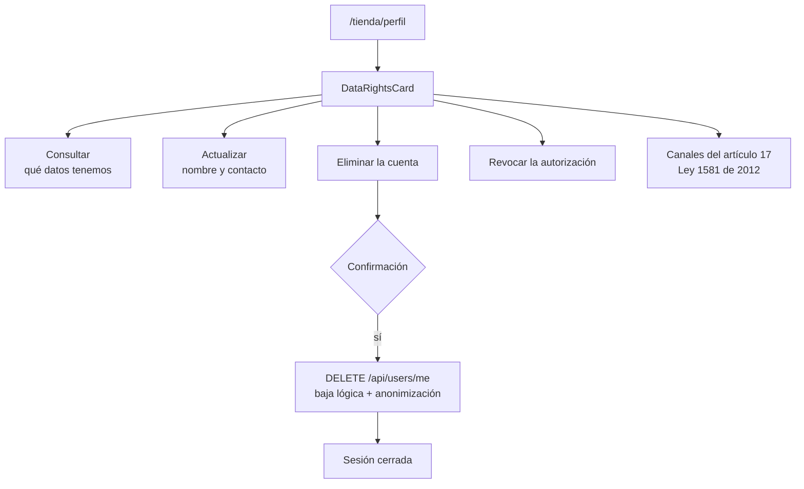

# User flow · navegación de Reverde

Diagramas de la navegación **tal como está implementada** en
`src/App.tsx` y `src/lib/routes.ts`. Si una ruta cambia en el código, este
documento cambia con ella.

## 1 · Mapa completo de navegación

## 2 · Guardas de acceso

Implementadas en `RequireRole` (`src/App.tsx`) y en `ConsentBoundary`.

| Desde | Rol | Resultado |
|---|---|---|
| `/app/*` | sin sesión | → `/login` |
| `/app/*` | `cliente` | → `/tienda` |
| `/app/*` | `superadmin` | → `/admin/inicio` |
| `/admin/*` | `supermercado` · `restaurante` | → `/app/inicio` |
| `/tienda/*` | cualquiera, incluso sin sesión | accesible (el catálogo es público) |
| ruta inexistente | cualquiera | → `/` |

## 3 · Flujo del administrador: de la alerta a la venta

Es el recorrido que demuestra la propuesta de valor completa.

## 4 · Flujo de compra y pago

El estado del pago y el estado logístico son **independientes**
(`OrderStatus` y `FulfillmentStatus` en el esquema).

## 5 · Alta de un establecimiento

Implementado en la API (`/api/establishments/requests` y
`/api/admin/requests/:id/{approve,reject}`). **Todavía sin pantallas en la SPA**
— ver Should-have S3 en [`mvp-moscow.md`](../estrategia/mvp-moscow.md).

> **El rol nunca se autoasigna.** Quien se registra siempre entra como `cliente`;
> convertirse en establecimiento exige aprobación. Es una decisión de seguridad
> deliberada (ver [`seguridad.md`](../arquitectura/seguridad.md)).

## 6 · Ejercicio de los derechos del titular (Habeas Data)

## Puntos de fricción conocidos del flujo

| # | Fricción | Dónde | Estado |
|---|---|---|---|
| F1 | El inventario inicial se digita producto por producto | `/app/inventario` | Could-have C1 (importación CSV) |
| F2 | No hay pantalla para solicitar cuenta de establecimiento | falta en `/login` | Should-have S3 |
| F3 | El cliente no recibe aviso cuando se publica algo cerca | — | Could-have C3 |
| F4 | `TODO:` validar si el gate de consentimiento antes de `/login` reduce el registro | `ConsentBoundary` | Por medir |
