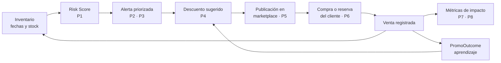

# Definición del problema · Matriz Problema–Solución

> Fuente de las afirmaciones: este documento solo recoge decisiones que ya están
> tomadas en el código de Reverde. Lo que todavía no se ha decidido o no se ha
> validado con datos aparece marcado como `TODO:`.

## El problema en una frase

Los establecimientos de alimentos **descubren demasiado tarde** qué productos van
a convertirse en desperdicio: cuando lo notan, el producto ya no tiene valor
comercial y la única salida es la merma.

No es un problema de falta de datos —el inventario y las fechas de vencimiento ya
existen en el establecimiento— sino de **falta de priorización y de un canal de
salida rápido**. Quien administra un supermercado o un restaurante no necesita un
informe: necesita saber **qué hacer hoy con estos tres productos**.

## Actores

Reverde es **B2B2C**: hay dos lados del mercado y un rol de supervisión. Los
cuatro roles son los que existen en el modelo de datos (`UserRole` en
`server/prisma/schema.prisma`):

| Rol | Lado | Qué hace en la plataforma |
|---|---|---|
| `supermercado` | Oferta (B2B) | Administra inventario, recibe alertas, aplica descuentos, publica |
| `restaurante` | Oferta (B2B) | Igual, con catálogo de preparados y cajas de rescate |
| `cliente` | Demanda (B2C) | Explora el marketplace, compra o reserva a precio reducido |
| `superadmin` | Supervisión | Audita la red, aprueba establecimientos, ve el impacto agregado |

## Matriz Problema–Solución

| # | Problema | A quién le duele | Cómo se manifiesta hoy | Solución de Reverde | Dónde está en el código | Cómo se mide |
|---|---|---|---|---|---|---|
| P1 | El riesgo de desperdicio no es visible hasta que es irreversible | Administrador del establecimiento | Se revisa el inventario "a ojo" o por recorrido físico de góndola | **Risk Score 0–100** por producto, recalculado de forma continua, con nivel bajo / medio / alto | `server/src/domain/risk.ts` · `src/lib/ai.ts` | Nº de productos en riesgo alto detectados antes del vencimiento |
| P2 | Aun viendo el riesgo, no se sabe qué acción tomar | Administrador | La decisión depende de la experiencia de quien esté en turno | **Recomendación con acción concreta** (descuento sugerido + publicar + donar) y nivel de confianza | `Recommendation` en el esquema · `/api/recommendations` | % de recomendaciones aplicadas |
| P3 | Una sugerencia automática sin explicación no se obedece | Administrador | Desconfianza en "la caja negra"; se ignora la alerta | **Explicabilidad**: los cuatro factores del score con su peso y la fórmula a la vista | `src/components/AiRecommendation.tsx` · `explainRisk` | Tasa de apertura del panel "¿Por qué recomendamos esto?" |
| P4 | Descontar a ciegas destruye margen sin garantizar la venta | Administrador | Se liquida al 50 % "por si acaso" | **Aprendizaje sobre promociones pasadas**: qué descuento logró qué sell-through por categoría | `PromoOutcome` · `learnFromHistory()` | Margen recuperado por punto de descuento |
| P5 | No hay un canal de salida rápido para producto próximo a vencer | Establecimiento | Se dona informalmente o se pierde | **Marketplace de rescate** con publicación en un clic desde la alerta | `MarketplaceListing` · `/api/marketplace` | Tiempo entre alerta y publicación; % de stock publicado vendido |
| P6 | Comprar comida de rescate es incómodo e incierto | Cliente comprador | No se sabe qué hay disponible, ni dónde, ni hasta cuándo | **Catálogo con precio, vencimiento, distancia y mapa**, compra o reserva para recoger | `src/pages/client/` · `/api/orders` | Conversión de exploración a pedido |
| P7 | El esfuerzo ambiental no es demostrable | Establecimiento y cliente | No hay cifra que mostrar a dirección ni al consumidor | **Métricas de impacto**: kg evitados, dinero recuperado, equivalencias de CO₂ y agua | `src/lib/metrics.ts` · `/api/dashboard` | kg de desperdicio evitado y COP recuperados |
| P8 | Una red de establecimientos no se puede supervisar producto a producto | Operador de la plataforma | Sin visión agregada no hay forma de detectar quién no está usando el sistema | **Panel de superadministración** con impacto global, establecimientos y publicaciones | `src/pages/super/` · `/api/admin` | Establecimientos activos / total |

## El ciclo cerrado

Lo que distingue la propuesta no es ninguno de los ocho puntos por separado, sino
que **la salida de cada uno alimenta al siguiente**:

## Lo que NO resuelve Reverde

Delimitarlo evita promesas que el producto no cumple:

- **No hace logística.** No hay domiciliario ni ruta: la persona recoge en el
  establecimiento (`pickupWindow` en el modelo `Order`).
- **No gestiona la cadena de frío** ni la inocuidad del alimento. La
  responsabilidad sanitaria sigue siendo del establecimiento.
- **No es un ERP ni un POS.** No reemplaza el sistema de inventario del negocio;
  convive con él.
- **No predice la demanda futura** del establecimiento; estima el riesgo de
  desperdicio del stock que ya existe.
- **No intermedia donaciones** a bancos de alimentos: registra la donación como
  movimiento (`MovementType.donacion`), pero no coordina al receptor.

## Supuestos por validar

Ninguno de estos está verificado con datos; son hipótesis que el equipo asumió al
construir el MVP y que conviene probar antes de escalar.

| # | Supuesto | Cómo validarlo |
|---|---|---|
| S1 | El administrador está dispuesto a registrar/importar su inventario con fechas de vencimiento | `TODO:` entrevistas con 5 establecimientos |
| S2 | Un descuento entre 20 % y 40 % mueve el producto antes del vencimiento | `TODO:` medir sell-through real; hoy el motor parte de una heurística |
| S3 | Existe demanda de compra de producto próximo a vencer al precio ofrecido | `TODO:` prueba de concepto con un establecimiento piloto |
| S4 | El Risk Score heurístico es suficiente antes de necesitar un modelo entrenado | Comparar score vs. merma real durante 1 mes |

## Pendientes de producto

- `TODO:` **Modelo de negocio.** No hay ninguna decisión de monetización en el
  código (no existen modelos de suscripción, comisión ni facturación). Hay que
  definir si Reverde cobra comisión por venta, suscripción al establecimiento, o
  ninguna de las dos en el MVP.
- `TODO:` **Alcance geográfico inicial.** El código asume Bogotá (`es-CO`,
  `America/Bogota`, COP) pero no hay una localidad ni un número de
  establecimientos objetivo definido.
- `TODO:` **Tamaño del problema con cifras locales.** Falta la fuente que
  cuantifique el desperdicio de alimentos en el retail colombiano (DANE, FAO,
  Ministerio de Ambiente) para sustentar la oportunidad.
