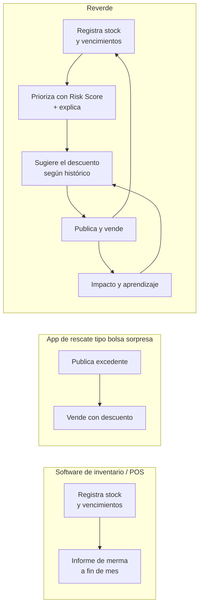

# Propuesta Única de Valor (UVP)

## La propuesta

> **Reverde le dice al establecimiento qué producto va a convertirse en
> desperdicio, por qué, y qué hacer hoy para evitarlo — y le abre el canal de
> venta en el mismo clic.**

Para clientes compradores, la misma frase vista desde el otro lado:

> **Comida buena de supermercados y restaurantes cerca de ti, más barata porque
> está a punto de perderse.**

### Fórmula

| Componente | Reverde |
|---|---|
| **Para** | administradores de supermercados y restaurantes en Bogotá |
| **que** | pierden producto porque detectan el riesgo de vencimiento demasiado tarde |
| **Reverde es** | un sistema de priorización de riesgo de desperdicio con canal de venta integrado |
| **que** | señala qué producto atender hoy, explica por qué, sugiere el descuento y lo publica |
| **a diferencia de** | un software de inventario (que registra pero no prioriza) o una app de rescate (que vende pero no decide) |
| **Reverde** | cierra el ciclo: la venta vuelve al inventario, a las métricas y al aprendizaje del motor |

## El diferencial, en una línea

Las demás herramientas resuelven **media cadena**. Reverde conecta las dos mitades:
el inventario alimenta la decisión, y la decisión alimenta la venta.

## Tabla comparativa

> ⚠️ **Investigación pendiente.** Las columnas de competidores describen
> **categorías de solución**, no auditorías de producto. Los nombres propios son
> candidatos a verificar: `TODO:` confirmar qué competidores operan efectivamente
> en Colombia, con qué funcionalidades, condiciones comerciales y comisión, antes
> de usar esta tabla fuera del equipo.

| Capacidad | **Reverde** | App de rescate de excedentes (`TODO:` ¿Too Good To Go u otra en Colombia?) | Software de inventario / POS (`TODO:` nombrar los locales) | Liquidación manual en tienda | Donación a banco de alimentos |
|---|---|---|---|---|---|
| Registra inventario con fecha de vencimiento | ✅ | ❌ (publica lotes, no gestiona stock) | ✅ | ❌ | ❌ |
| **Predice qué producto va a desperdiciarse** | ✅ Risk Score 0–100 | ❌ | ⚠️ alertas por fecha fija, sin priorizar | ❌ criterio humano | ❌ |
| **Explica por qué** (explicabilidad) | ✅ 4 factores con peso + fórmula visible | ❌ | ❌ | n/a | n/a |
| Sugiere el descuento óptimo | ✅ con confianza declarada | ❌ precio fijo por bolsa | ❌ | ❌ | n/a |
| **Aprende de promociones pasadas** | ✅ `PromoOutcome` por categoría | ❌ | ❌ | ❌ | ❌ |
| Canal de venta al consumidor | ✅ marketplace propio | ✅ | ❌ | ⚠️ solo quien está en la tienda | ❌ |
| El comprador sabe **qué** compra | ✅ producto, cantidad y fecha explícitos | ❌ bolsa sorpresa | n/a | ✅ | n/a |
| Reserva de stock con expiración | ✅ `reservedQuantity` + `expiresAt` | ⚠️ varía | ❌ | ❌ | ❌ |
| Pago local (PSE · Nequi · Bancolombia · tarjeta · en el local) | ✅ vía Wompi | ⚠️ `TODO:` verificar | n/a | efectivo | n/a |
| Métricas de impacto ambiental | ✅ kg, CO₂, agua, COP recuperados | ✅ kg/comidas | ❌ | ❌ | ⚠️ certificado |
| Supervisión multi-establecimiento | ✅ panel de superadmin | ❌ | ⚠️ por licencia | ❌ | ❌ |
| Multi-tenant con aislamiento por establecimiento | ✅ `establishmentId` en toda entidad | n/a | ⚠️ varía | n/a | n/a |
| Costo para el establecimiento | `TODO:` **sin definir** | comisión por bolsa | licencia mensual | 0 | 0 |
| Recupera dinero del producto | ✅ | ✅ | ❌ | ✅ parcial | ❌ (beneficio tributario) |

### Dónde Reverde está en desventaja

Decirlo es parte de la propuesta de valor, porque define qué hay que construir
después:

| Desventaja | Frente a quién | Consecuencia |
|---|---|---|
| **Sin masa de compradores** | Apps de rescate ya instaladas | Arranque en frío: el establecimiento publica y no hay quien compre |
| **El inventario hay que cargarlo** | POS / ERP que ya lo tienen | La mayor fricción de adopción del MVP |
| **Risk Score heurístico, no entrenado** | Cualquier solución con datos históricos reales | La precisión está por validar (supuesto S4) |
| **Sin logística ni domicilio** | Apps de delivery | Limita el alcance a quien puede ir a recoger |
| **Sin integración con POS** | Software de inventario | Doble digitación mientras no exista |

## Mensajes por audiencia

| Audiencia | Mensaje principal | Prueba que lo respalda en el producto |
|---|---|---|
| Administrador de establecimiento | «Deja de descubrir la merma cuando ya es merma» | Risk Score + alertas priorizadas |
| Dirección / dueño del negocio | «Recuperaste $X y evitaste Y kg este mes» | Pantalla de Impacto |
| Cliente comprador | «Lo mismo, más barato, antes de que se pierda» | Catálogo con ahorro, fecha y distancia |
| Superadministrador / operador | «Mira la red completa sin entrar producto por producto» | Panel global |
| Jurado académico / evaluador | «La IA se puede auditar: cada recomendación muestra su fórmula» | Panel «¿Por qué recomendamos esto?» |

## Lo que hay que decidir

1. `TODO:` **El eslogan oficial.** El código usa *«Menos desperdicio, más valor»* (`README.md`). Confirmar si es el definitivo.
2. `TODO:` **El competidor de referencia.** Sin saber contra quién se compite en Bogotá, la tabla de arriba es una hipótesis.
3. `TODO:` **El gancho principal para el comprador:** ahorro o sostenibilidad. Hoy la UI apuesta por el ahorro y el impacto aparece como refuerzo.
4. `TODO:` **El modelo de negocio**, porque define si la UVP para el establecimiento es «recuperas dinero» o «pagas menos que lo que pierdes».
